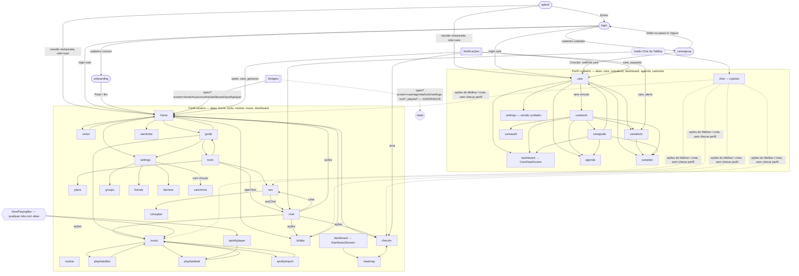

# Navegação atual do app MellowPet

Levantamento feito lendo o código da branch `feat/cuidador-ux-navegacao`. Os caminhos são relativos a `app/src/`, salvo indicação. Nenhum código foi alterado.

---

## 1. Como a navegação funciona

### Biblioteca
O app não usa biblioteca de navegação: não há `expo-router` nem `react-navigation`. A navegação é feita em casa:

- **Estado**: `state.screen: Screen` (tela atual), `state.history: Screen[]` (pilha do "voltar") e `state.navSeq` (contador que só existe para refazer a animação de entrada e, em alguns casos, para recarregar dados) — `state/AppContext.tsx:150-157`.
- **Tipo `Screen`**: união com 35 ids — `state/AppContext.tsx:96-131`.
- **Mapa tela→componente**: `SCREENS: Record<Screen, React.ComponentType>` — `navigation/RootNavigator.tsx:49-85`. Única tela que depende do perfil: `dashboard` → `DashboardEntry`, que mostra `CareDataScreen` para o cuidador e `DashboardScreen` para o usuário (`RootNavigator.tsx:87-90`).
- **Transição**: só um fade de 180 ms a cada troca de `screen` (`RootNavigator.tsx:130-134`). Não existe pilha de componentes montados: a tela anterior é desmontada e o estado local dela se perde.

### Histórico (reducer)
- `reducer` (`AppContext.tsx:429-442`): **toda** troca de `screen` em que o patch não traz `history` empilha a tela anterior, limitada às 20 últimas (`:433-436`). Isso vale para `actions.go`, para `actions.set({ screen })` e para os dispatches de deep link e notificação.
- `NO_HISTORY = ['splash','login','onboarding','caresignup']` (`AppContext.tsx:427`): essas telas nunca entram na pilha.
- `actions.go(screen)` (`AppContext.tsx:962`): navega e empilha.
- `actions.back()` (`AppContext.tsx:965-971`): tira o topo da pilha e vai para ele. Retorna `false` se a pilha está vazia.
- `actions.goTab(screen)` (`AppContext.tsx:973`): navega e **zera** o histórico. É usado pela TabBar e como fallback do voltar.

### Voltar
- **Botão "Voltar" visual**: aparece no `ScreenTitle` (`components/ui.tsx:68-80`) quando `history.length > 0` e a tela **não** está em `TAB_ROOTS = ['home','tools','routine','music','dashboard','care','carealerts','agenda','caretools']` (`ui.tsx:65`, `:71`).
- **Voltar próprio** (telas sem `ScreenTitle`): Chat (`screens/ChatScreen.tsx:131`, `back() || goTab(home do perfil)`), Visão (`screens/VisionScreen.tsx:70`, `back() || goTab('home')`), Player Spotify (`screens/SpotifyPlayerScreen.tsx:148`, `back() || goTab('music')`), Cadastro de cuidador (`screens/CareSignupScreen.tsx:96-102`: no passo 0 faz `logout`, nos outros volta um passo de `careStep`).
- **Botão físico (Android)** (`RootNavigator.tsx:111-121`): sem sessão, sai do app. Com sessão, tenta `actions.back()` primeiro; com a pilha vazia, sai do app se estiver na raiz (`home`/`care`/`splash`) ou vai para a inicial do perfil via `goTab`.

### Guards
- **Autenticação** (`RootNavigator.tsx:92-107`): `PUBLIC_SCREENS = ['splash','login']`. Sem `userId`, qualquer outra tela é *renderizada* como `login`, mas `state.screen` não muda. TabBar e NowPlayingBar somem (`:124`).
- **Perfil**: **não existe guard por perfil no navegador**. O perfil só define:
  - qual é a tela inicial (`home` ou `care`) — `RootNavigator.tsx:102`, `AppContext.tsx:758`, `:1216`, `:1251`;
  - quais abas aparecem (`components/TabBar.tsx:32`);
  - o componente de `dashboard` (`RootNavigator.tsx:87-90`).
  - `actions.setRole('care')` só funciona se `accountRole === 'care'` (`AppContext.tsx:1213`). Não existe nenhuma chamada a `setRole('user')`.
  - Algumas telas se adaptam por dentro: Ajustes esconde os blocos do usuário para o cuidador (`screens/SettingsScreen.tsx:270-573`) e o Chat muda prompts e textos (`ChatScreen.tsx:68`, `:96`). As telas de cuidado usam `CareGate`, que mostra um estado vazio quando não há vínculo (`components/CareStates.tsx:100-115`).
- **Telas sem TabBar**: `NO_TABS = ['splash','onboarding','chat','login','caresignup','vision','spotifyplayer']` (`RootNavigator.tsx:96`).
- **Coach (tour)**: aparece só em `home` com `state.coach < COACH.length` (`RootNavigator.tsx:125`).

### TabBar (`components/TabBar.tsx`)
| Perfil | Abas (id → rótulo) | Linha |
|---|---|---|
| Usuário | home→Home, tools→Ferramentas, routine→Rotina, music→Música, dashboard→Bem-estar | `TabBar.tsx:11-17` |
| Cuidador | care→Painel, carealerts→Alertas, dashboard→Dados, agenda→Agenda, caretools→Mais | `TabBar.tsx:19-25` |
| Ambos | botão redondo de Chat → `actions.go('chat')` (empilha; não é aba) | `TabBar.tsx:81-82` |

As abas usam `goTab` e zeram o histórico (`TabBar.tsx:64`).

---

## 2. Tabela de telas

Legenda — **Perfil**: perfil que deveria acessar (U = usuário, C = cuidador, — = sem sessão). **Tab**: aparece como aba. **Voltar**: S = `ScreenTitle` com voltar (quando há histórico), P = voltar próprio, R = raiz/aba (sem voltar visual), N = nenhum.

| id | Componente / arquivo | Perfil | Como se chega (arquivo:linha) | Tab | Voltar |
|---|---|---|---|---|---|
| `splash` | `SplashScreen` — `screens/SplashScreen.tsx` | — | estado inicial (`AppContext.tsx:311`) | não (NO_TABS) | N (físico sai) |
| `login` | `LoginScreen` — `screens/LoginScreen.tsx` | — | Splash "Entrar" (`SplashScreen.tsx:118`); logout (`AppContext.tsx:797`); guard sem sessão (`RootNavigator.tsx:106`). Login e cadastro são abas internas (`LoginScreen.tsx:212`) | não | N |
| `onboarding` | `OnboardingScreen` — `screens/OnboardingScreen.tsx` | U | cadastro de usuário comum (`AppContext.tsx:1249-1250`) | não | N (só "Pular"/avançar → `home`, `OnboardingScreen.tsx:124`, `:133`) |
| `caresignup` | `CareSignupScreen` — `screens/CareSignupScreen.tsx` | C | cadastro de cuidador (`AppContext.tsx:1247-1248`) | não | P (`CareSignupScreen.tsx:96-102`); "Concluir" → `setRole('care')` → `care` (`:297`) |
| `home` | `HomeScreen` — `screens/HomeScreen.tsx` | U | inicial do usuário (`AppContext.tsx:758`, `:1253`); aba; Onboarding (`OnboardingScreen.tsx:124`, `:133`); Lullaby (`LullabyScreen.tsx:103`); Vision (`VisionScreen.tsx:54`); Guia "Iniciar tour" (`GuideScreen.tsx:55`); cards do Guia (`GuideScreen.tsx:76`); `openTool` respiração/home (`AppContext.tsx:1173`, `:1179`); chat "respirar" (`AppContext.tsx:1347`); widgets e notificações (seção 3) | sim (U) | R |
| `tools` | `ToolsScreen` — `screens/ToolsScreen.tsx` | U | aba; card do Guia (`data/content.ts:486` via `GuideScreen.tsx:76`) | sim (U) | R |
| `routine` | `RoutineScreen` — `screens/RoutineScreen.tsx` | U | aba; widget `open?screen=routine` | sim (U) | R |
| `music` | `MusicScreen` — `screens/MusicScreen.tsx` | U | aba; card do Guia (`content.ts:492`); chat "musica" (`AppContext.tsx:1348`); NowPlayingBar música local (`components/NowPlayingBar.tsx:83`); PlaylistEditor (`PlaylistEditorScreen.tsx:156`, `:342`, `:352`); PlaylistDetail (`PlaylistDetailScreen.tsx:233`, `:557`, `:588`); SpotifyImport (`SpotifyImportScreen.tsx:158`, `:177`, `:328`); fallback do Player (`SpotifyPlayerScreen.tsx:148`) | sim (U) | R |
| `playlisteditor` | `PlaylistEditorScreen` | U | Música "nova playlist" (`MusicScreen.tsx:455`) | sim, sem destaque | S |
| `playlistdetail` | `PlaylistDetailScreen` | U | Música (`MusicScreen.tsx:54-59`); Player (`SpotifyPlayerScreen.tsx:297-302`). **Parâmetro implícito** `state.openPlaylistId` (`PlaylistDetailScreen.tsx:60`) | sim, sem destaque | S |
| `spotifyimport` | `SpotifyImportScreen` | U | Música (`MusicScreen.tsx:475`) | sim, sem destaque | S |
| `spotifyplayer` | `SpotifyPlayerScreen` | U | NowPlayingBar (`NowPlayingBar.tsx:82`, `:97`); widget `open?screen=spotifyplayer` | não | P |
| `dashboard` | `DashboardEntry` → `DashboardScreen` (U) / `CareDataScreen` (C) — `RootNavigator.tsx:87-90` | U e C | aba dos dois perfis; Care "Ver evolução"/"Abrir relatório"/atalho "Relatório" (`CareScreen.tsx:155`, `:160`); CareTools "Relatório de cuidado" (`content.ts:410` via `CareToolsScreen.tsx:82`); CareGuide passo 2 (`CareGuideScreen.tsx:12`, `:38`); widget `open?screen=dashboard` | sim (U e C) | R |
| `checkin` | `CheckinScreen` | U | Home (`HomeScreen.tsx:650`); DivergenceCard na Home (`components/DivergenceCard.tsx:45`); Heatmap (`HeatmapScreen.tsx:295`); chat "checkin"/"diario" (`AppContext.tsx:1350`); notificação `ema`; widget `open?screen=checkin` (permitido, mas nenhum widget usa) | sim, sem destaque | S |
| `heatmap` | `HeatmapScreen` | U | Dashboard (`DashboardScreen.tsx:128`); Checkin (`CheckinScreen.tsx:496`) | sim, sem destaque | S |
| `friends` | `FriendsScreen` | U | Ajustes (`SettingsScreen.tsx:441`) | sim, sem destaque | S |
| `fairness` | `FairnessScreen` | U | CalibrationCard (`components/CalibrationCard.tsx:43`) em Ajustes (`SettingsScreen.tsx:326`) | sim, sem destaque | S |
| `lullaby` | `LullabyScreen` | U | Home (`HomeScreen.tsx:501`); chat "ninar" (`AppContext.tsx:1349`) | sim, sem destaque | S + botão "Voltar para a Home" (`LullabyScreen.tsx:103`, usa `go`) |
| `sos` | `SosScreen` | U | Ferramentas (`ToolsScreen.tsx:378`); Chat, mensagem de crise (`ChatScreen.tsx:286`); `actions.sos` (`AppContext.tsx:1158`) | sim, sem destaque | S |
| `crisisplan` | `CrisisPlanScreen` | U | SOS (`SosScreen.tsx:150`) | sim, sem destaque | S |
| `caremirror` | `CareMirrorScreen` | U (com vínculo) | Ajustes, "Ver o que meu cuidador vê", só com `primaryLink` (`SettingsScreen.tsx:503-510`) | sim, sem destaque | S |
| `groups` | `GroupsScreen` | U | Ajustes (`SettingsScreen.tsx:332`) | sim, sem destaque | S |
| `wardrobe` | `WardrobeScreen` | U | Home (`HomeScreen.tsx:496`) | sim, sem destaque | S |
| `care` | `CareScreen` — `screens/CareScreen.tsx` | C | inicial do cuidador (`AppContext.tsx:758`, `:1252`); aba; `setRole('care')` (`CareSignupScreen.tsx:297`, `SettingsScreen.tsx:554`); CareGuide passo 1 (`CareGuideScreen.tsx:11`); notificação `care_request(s)`; widgets `open?screen=care` (**ignorados**, ver 5.1) | sim (C) | R |
| `carealerts` | `CareAlertsScreen` | C | aba; Care banner e atalho (`CareScreen.tsx:152`, `:160`); CareTools (`content.ts:411`); notificação `care_alert(s)` | sim (C) | R |
| `careaudit` | `CareAuditScreen` | C | só por CareTools "Histórico" (`content.ts:415` via `CareToolsScreen.tsx:82`) | sim, sem destaque | S |
| `careplan` | `CarePlanScreen` | C | Care atalho "Plano" (`CareScreen.tsx:160`); CareAlerts (`CareAlertsScreen.tsx:127`); CareTools "Plano" e "Equipe e notas" (`content.ts:412`, `:414`); CareGuide passo 4 (`CareGuideScreen.tsx:14`) | sim, sem destaque | S |
| `careguide` | `CareGuideScreen` | C | só por CareTools "Guia do cuidador" (`CareToolsScreen.tsx:122`) | sim, sem destaque | S |
| `agenda` | `AgendaScreen` | C | aba; Care atalho "Check-in" (`CareScreen.tsx:160`); CareTools "Check-ins" (`content.ts:413`); CareGuide passo 3 (`CareGuideScreen.tsx:13`); widget `open?screen=agenda` (**ignorado**, ver 5.1) | sim (C) | R |
| `caretools` | `CareToolsScreen` | C | aba "Mais"; Care estado vazio (`CareScreen.tsx:140`); `CareGate` vazio em todas as telas de cuidado (`CareStates.tsx:111`) | sim (C) | R |
| `chat` | `ChatScreen` | U e C (conteúdo muda por perfil) | botão central da TabBar (`TabBar.tsx:82`); `openTool` genérico (`AppContext.tsx:1182-1189`); SOS "conversar" (`SosScreen.tsx:159` → `AppContext.tsx:1160-1165`) | não | P |
| `guide` | `GuideScreen` | U | Home (`HomeScreen.tsx:242`); Ferramentas (`ToolsScreen.tsx:321`) | sim, sem destaque | S |
| `plans` | `PlansScreen` | U | Ferramentas (`ToolsScreen.tsx:350`) | sim, sem destaque | S |
| `settings` | `SettingsScreen` | U e C (conteúdo muda por perfil) | Home (`HomeScreen.tsx:243`, `:381`); Care (`CareScreen.tsx:137`); card do Guia (`content.ts:498`); widget `open?screen=settings` (**ignorado**) | sim, sem destaque | S |
| `vision` | `VisionScreen` | U | Home (`HomeScreen.tsx:225`) | não | P (`VisionScreen.tsx:70`) + "voltar à Home" (`:54`, usa `go`) |

"sim, sem destaque" quer dizer que a TabBar aparece, mas nenhuma aba fica marcada, porque a marcação é `state.screen === key` (`TabBar.tsx:60`).

---

## 3. Deep links e notificações

Scheme `mellowpet` (`app/app.json:5`). O handler é `handleUrl` em `AppContext.tsx:810-894` (via `Linking.getInitialURL` e `Linking.addEventListener('url')`). Os widgets Android montam `mellowpet://widget/<path>` em `app/modules/mellow-widget/android/src/main/java/com/mellowpet/widget/WidgetIntents.kt:15-16`.

### 3.1 Deep links tratados pelo app
| URL | Parâmetros | Efeito | Linha |
|---|---|---|---|
| `mellowpet://widget/open?screen=X` | `screen` ∈ `['home','music','routine','spotifyplayer','checkin','heatmap','dashboard']` | `screen = X` (empilha). Fora da lista: **ignorado sem aviso** | `AppContext.tsx:815-820` |
| `mellowpet://widget/mood?value=E` | `value` = chave de `EMOTIONS` ≠ `unknown` | registra a emoção (no máximo 1 por minuto) e vai para `home` | `AppContext.tsx:821-836` |
| `mellowpet://widget/care?action=A` | `action` ∈ `feed`/`play`/`rest` | aplica XP/humor (no máximo 1 a cada 30 s) e vai para `home`; refeição esgotada → `home` com `fedFull` | `AppContext.tsx:837-881` |
| `mellowpet://widget/spotify?action=A` | `pause`/`resume`/`next`/`previous` | controla o Spotify sem navegar | `spotify/spotifyClient.tsx:347-362` |
| `mellowpet://spotify-callback` | OAuth | redirect do Spotify | `spotify/spotifyAuth.ts:20` |

### 3.2 Deep links que os widgets emitem (Kotlin)
| Path emitido | Widgets (arquivo:linha) | Tratado? |
|---|---|---|
| `open?screen=home` | Badges:35, Care:40, Hero:60, Level:31, MellowMood:50, Quote:28, MellowBackgroundService:74, VisionBackgroundService:128 (mellow-vision) | sim |
| `open?screen=dashboard` | Goals:35, Streak:41, Timeline:37, Triggers:36, Wellbeing:28 | sim (o perfil decide o componente) |
| `open?screen=routine` | Capsule:26, Routine:76, Sleep:38 | sim |
| `open?screen=music` | Playlists:35 (sem playlist), Playlists:37 | sim |
| `open?screen=spotifyplayer` | MusicCompact:37, SpotifyNowPlaying:53 | sim |
| `care?action=feed/play/rest` | CareWidgetProvider:37-39 | sim |
| `open?screen=care` | CareAlert:28, Caregiver:39, Checkin:29, Checkin:30 | **não** (fora de `allowed`) |
| `open?screen=agenda` | AgendaWidgetProvider:31 | **não** |
| `open?screen=tools` | NextStep:31, Plan:31, Tools:30 | **não** |
| `open?screen=settings` | HomeDevices:27, :29 | **não** |
| `tool?action=breathe/focus/ground/journal/sos/...` | Breathe:27, Focus:29, Grounding:26, Journal:26, Help:26, Tools:28 | **não** (o `handleUrl` não tem ramo `tool`) |
| `playlist?id=<id>` | PlaylistsWidgetProvider:35 | **não** (não há ramo `playlist`) |

(Os arquivos ficam em `app/modules/mellow-widget/android/src/main/java/com/mellowpet/widget/`, com nome `<Nome>WidgetProvider.kt`.) As ações "no lugar" (`WidgetIntents.action`, por exemplo QuickMood, PetTap, mídia) não abrem o app. Elas são drenadas por `drainPendingWidgetActions` (`AppContext.tsx:698-714`) e não navegam.

### 3.3 Notificações (toque)
Handler em `AppContext.tsx:900-925`, com `getLastNotificationResponse` (app frio) e `addNotificationResponseReceivedListener`. O roteamento usa `data.kind`:

| `data.kind` | Destino | Origem |
|---|---|---|
| `ema` | `checkin` | local, `notifications/notifications.ts:138` |
| `water` | `home` | local, `notifications/notifications.ts:113` |
| `care_gestures` | `home` | push, `supabase/functions/care-push/index.ts:62` (vai para a pessoa acompanhada, `:36-37`) |
| `care_alert` / `care_alerts` | `carealerts` | local `CareScreen.tsx:72`; push `care-push/index.ts:62` (vai para os cuidadores) |
| `care_request` / `care_requests` | `care` | local `components/CarePresence.tsx:113`; push `care-push/index.ts:62` |

Os payloads de push só levam `{ kind }` (`care-push/index.ts:62`): não vão id da pessoa nem do alerta. Com o app frio ou sem sessão, o destino fica guardado em `pendingScreen` e abre quando a tela atual for `home` ou `care` (`AppContext.tsx:631-637`, `:915-919`).

---

## 4. Diagrama do fluxo atual

---

## 5. Suspeitas de problemas

### 5.1 Deep links de widget quebrados ou ignorados
1. **Widgets do cuidador não abrem nada.** `CareAlertWidgetProvider.kt:28`, `CaregiverWidgetProvider.kt:39` e `CheckinWidgetProvider.kt:29-30` emitem `open?screen=care`, e `AgendaWidgetProvider.kt:31` emite `open?screen=agenda`. Nenhum dos dois está em `allowed` (`AppContext.tsx:817`), então o app abre na tela atual sem navegar.
2. **`open?screen=tools` e `open?screen=settings` também são ignorados**: NextStep:31, Plan:31, Tools:30, HomeDevices:27/29 contra a mesma `allowed` em `AppContext.tsx:817`.
3. **`tool?action=...` não tem tratamento** (Breathe:27, Focus:29, Grounding:26, Journal:26, Help:26 com `sos`, Tools:28). O `handleUrl` só reconhece `/widget/open`, `/widget/mood` e `/widget/care` (`AppContext.tsx:815-881`). O widget de ajuda (SOS) não leva à tela `sos`.
4. **`playlist?id=` não tem tratamento** (`PlaylistsWidgetProvider.kt:35`). Não há ramo que preencha `openPlaylistId` e abra `playlistdetail`.
5. **`/widget/mood` não tem emissor**: nenhum widget gera essa URL (QuickMood usa broadcast, `QuickMoodWidgetProvider.kt:29`). O ramo em `AppContext.tsx:821-836` parece código morto, ou é legado. O mesmo vale para `widget/spotify` (`spotifyClient.tsx:349`): os widgets de mídia usam `WidgetIntents.action` (`SpotifyNowPlayingWidgetProvider.kt:48-52`).
6. **Possível corrida no cold start**: o `widget/open` despacha a tela assim que `getInitialURL` resolve (`AppContext.tsx:889-891`). Depois, `loadStoredSession` sobrescreve `screen` com `home`/`care` (`AppContext.tsx:752-760`), e o destino do widget pode se perder. As notificações têm `pendingScreen` para esse caso; os deep links não têm.

### 5.2 Perfil errado alcançando telas
7. **Não há guard por perfil**: `SCREENS` aceita qualquer `Screen` para qualquer `role` (`RootNavigator.tsx:49-85`, `:123`).
8. **Cuidador chega a telas do usuário pelo Chat**: o botão de Chat aparece para o cuidador (`TabBar.tsx:81-82`), e as ações sugeridas `runChatAction` mandam para `home`, `music`, `lullaby` e `checkin` sem checar perfil (`AppContext.tsx:1344-1351`, botão em `ChatScreen.tsx:304`). A mensagem de crise leva a `sos` (`ChatScreen.tsx:286`), e de lá a `crisisplan`, o plano de crise do *próprio* cuidador.
9. **Cuidador cai na Home do usuário (pet) por widget ou notificação**: `widget/care` e `widget/mood` forçam `screen: 'home'` (`AppContext.tsx:834`, `:855`, `:870`); `widget/open` permite `home`/`music`/`routine`/`checkin`/`heatmap`/`spotifyplayer` sem olhar `role` (`:817-819`); `water` e `ema` são notificações locais agendadas no aparelho e continuam valendo depois de trocar de conta (`AppContext.tsx:905-908`).
10. **Usuário pode cair em `carealerts`/`care`** se o aparelho receber uma notificação `care_*` (`AppContext.tsx:909-912`), por exemplo depois de trocar de conta no mesmo aparelho. Nesse caso a TabBar do usuário aparece em cima de uma tela de cuidador. O `pendingScreen` aplica o destino em `home` **ou** `care`, qualquer que seja o perfil (`AppContext.tsx:634`).
11. **NowPlayingBar aparece para o cuidador** em qualquer tela com abas (`RootNavigator.tsx:144`) e leva a `spotifyplayer`/`music` (`NowPlayingBar.tsx:82-83`, `:97`).

### 5.3 Fluxos mortos, textos enganosos, telas quase órfãs
12. **"Ver painel de cuidador" não aparece nunca**: ele exige `accountRole === 'care'` (`SettingsScreen.tsx:552`), mas está dentro do bloco `state.role !== 'care'` (`:270`). Como não existe `setRole('user')` e o login/restore usam `role = accountRole` (`AppContext.tsx:756-757`, `:1240-1241`), as duas condições nunca são verdadeiras juntas. O card do Guia "Modo cuidador: Em Ajustes › Conexões você entra no painel" (`data/content.ts:495-498`) promete um caminho que não existe para o usuário.
13. **Texto do Coach desatualizado**: "Ferramentas, Música e Cuidado ficam na barra de baixo" (`data/content.ts:506`), mas as abas do usuário são Home, Ferramentas, Rotina, Música e Bem-estar (`TabBar.tsx:11-17`). Não há aba "Cuidado".
14. **`careguide` e `careaudit` só são alcançáveis por CareTools** (`CareToolsScreen.tsx:122`, `content.ts:415`). Não há link a partir do Painel nem dos Alertas.
15. **"Equipe e notas" e "Plano de cuidado" levam ao mesmo destino** (`content.ts:412` e `:414`, ambos `careplan`): dois cards para a mesma tela.
16. **`checkin` na `allowed` do widget, mas nenhum widget o emite**: `CheckinWidgetProvider.kt:29-30` usa `screen=care`. O "check-in" do widget é o do cuidador, que também não funciona (item 1).

### 5.4 Inconsistências de histórico e voltar
17. **Navegação para abas com `go` (não `goTab`) empilha histórico**, mas a tela é `TAB_ROOTS` e esconde o "Voltar" (`ui.tsx:65`, `:71`). O botão físico, porém, desempilha (`RootNavigator.tsx:115`), e o voltar visual e o físico divergem. Casos: `CareScreen.tsx:152`, `:155`, `:160` (para `carealerts`, `dashboard`, `agenda`); `CareStates.tsx:111` e `CareScreen.tsx:140` (para `caretools`); `LullabyScreen.tsx:103`, `VisionScreen.tsx:54`, `GuideScreen.tsx:55`/`:76` (para `home`/`tools`/`music`).
18. **Voltar físico depois de salvar leva de volta ao formulário**: PlaylistEditor e SpotifyImport fazem `go('music')` ao concluir (`PlaylistEditorScreen.tsx:156`, `SpotifyImportScreen.tsx:158`; PlaylistDetail depois de excluir, `PlaylistDetailScreen.tsx:557`). A pilha fica `[..., music, playlisteditor]` e o voltar físico na Música reabre o editor.
19. **Na raiz, o voltar físico não sai do app se houver histórico**: `actions.back()` é tentado antes de `atRoot` (`RootNavigator.tsx:115-116`). Exemplo: Chat → ação "respirar" → `home` (`AppContext.tsx:1347`); na Home, o voltar reabre o Chat.
20. **Ciclos na pilha**: `checkin` ↔ `heatmap` (`CheckinScreen.tsx:496`, `HeatmapScreen.tsx:295`) e Guia → Home → Guia empilham indefinidamente (limitado a 20, `AppContext.tsx:435`).
21. **Notificação durante onboarding ou cadastro de cuidador**: com `userId` definido e `screen` ≠ `splash`, o destino é aplicado na hora (`AppContext.tsx:915-916`). Isso tira a pessoa do `onboarding`/`caresignup`, que estão em `NO_HISTORY`, sem jeito de voltar a eles.

### 5.5 Parâmetros implícitos via estado global
22. **`playlistdetail` depende de `state.openPlaylistId`** (`PlaylistDetailScreen.tsx:60`), definido só em `MusicScreen.tsx:56` e `SpotifyPlayerScreen.tsx:299`. Sem ele, a tela mostra "Não encontrada" (`PlaylistDetailScreen.tsx:226-233`). É o motivo de `playlist?id=` não poder ser só um `open?screen=`.
23. **Telas de cuidado dependem de `state.person`** (pessoa selecionada) via `useCurrentCareLink` → `pickCurrent(links, state.person)`, que cai em `links[0]` quando falta (`components/CareStates.tsx:15-19`, `care/careSelection.ts:18-19`). A seleção só acontece no Painel (`CareScreen.tsx:146`). Uma notificação `care_alerts` (payload só com `kind`, `care-push/index.ts:62`) abre os alertas da pessoa *selecionada por último*, não necessariamente da que gerou o alerta.
24. **`AgendaScreen`, `CareAlertsScreen` etc. fazem `useCareLinks(state.userId, 'care')`** (`CareStates.tsx:17`). Se um usuário comum chega nelas (item 10), vê o estado vazio "Gere um convite em Recursos" e é levado a `caretools` (`CareStates.tsx:111`), que gera convite de cuidador para uma conta comum (`CareToolsScreen.tsx:34`).
25. **`MusicScreen` recarrega por `state.navSeq`** (`MusicScreen.tsx:52`). Qualquer navegação, inclusive para outras telas, dispara um reload enquanto ela está montada. Funciona, mas acopla dados à navegação.
26. **Guard de autenticação não reescreve `state.screen`** (`RootNavigator.tsx:106`): o login é renderizado com `state.screen` antigo (por exemplo `music`, vindo de um widget). Hoje o `submitAuth` sempre define `screen` (`AppContext.tsx:1247-1253`) e não há efeito colateral visível, mas a TabBar e o `ScreenTitle` leem `state.screen` direto (`TabBar.tsx:60`, `ui.tsx:71`).
