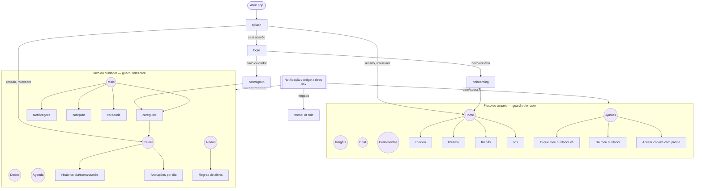

# Plano — Fase 3

## 1. Nova arquitetura de navegação

Continua a navegação própria (trocar para React Navigation/expo-router seria reescrever 35 telas sem ganho real). O que muda é que as regras saem do reducer para um módulo puro e testável, `app/src/navigation/navModel.ts` (contrato em `app/tests/nav_contract.test.mjs`):

- `SCREEN_ACCESS`: cada tela é `public`, `user`, `care` ou `both`.
- `canAccess(screen, { authed, role })`: o único guard. Vale para `go`, `back`, `goTab`, deep links, widgets, notificações e ações do Chat. Destino negado → `homeFor(role)`.
- `pushHistory` / `popHistory`: histórico sem duplicar o topo, sem telas de `NO_HISTORY`, limite 30; o pop pula entradas que o perfil não pode abrir.
- Fins de fluxo (salvar/cancelar/excluir) usam `replace` (troca a tela atual sem empilhar), não `go`.
- Logout limpa histórico **e** destino pendente.

## 2. Nova área do cuidador

| Item | Decisão |
|---|---|
| Painel com pessoas acompanhadas | Cartões de **todas** as pessoas com estado recente (score + "há X min") carregados em paralelo; a selecionada abre o detalhe. Vazio: "Você ainda não acompanha ninguém — gere um convite". Mostra status do convite pendente (aguardando / aceito / expirado). |
| Vínculo com consentimento | Já existe convite por código. Novo: a pessoa vê **prévia** do que será compartilhado antes de aceitar e o aceite grava `care_consents` com a versão do termo (`CARE_TERMS_VERSION`). Revogar e pausar continuam a qualquer momento. Ajustes da pessoa listam **todos** os cuidadores. |
| Histórico dia/semana/mês | RPC nova `care_history` em data local (`America/Sao_Paulo` por padrão), tela `carehistory` com seletor Dia (14) / Semana (12) / Mês (6) e barras empilhadas por humor + tendência. |
| Alertas configuráveis | Tabela `care_alert_rules` por vínculo (quantas leituras, em quantos minutos, quais emoções, liga/desliga). O trigger usa a regra quando existe; sem regra, o comportamento atual (incluindo o ajuste por falso alarme). Tela `carealertrules`. |
| Resumo semanal por IA | `POST /api/v1/care/weekly` recebe só agregados diários, devolve texto cuidadoso e não diagnóstico; sem IA, `text: null` e o app usa o resumo por regras atual. Guardado no aparelho por vínculo e semana (não vai para o banco). |
| Anotações por pessoa e dia | `caregiver_notes` ganha `note_day`, `updated_at`, editar e apagar pelo autor enquanto o vínculo está ativo. Tela `carenotes` agrupada por dia. |
| Notificações | Tabela `care_notification_prefs` por vínculo (alertas, pedidos, resumo semanal, silêncio noturno). A Edge Function `care-push` respeita as preferências; pedido "agora" fura o silêncio. Tela `carenotify`. |
| Pausa | Pausa esconde **dados**, não a voz da pessoa: pedidos "Preciso de você" continuam chegando ao cuidador durante a pausa (decisão: foi ela quem pediu). Carinho durante a pausa fica indisponível na interface com explicação. |
| Lado da pessoa | Tela `caredcare` "Do meu cuidador": plano de cuidado e próximos compromissos que o cuidador criou para ela (somente leitura). |

## 3. Correções obrigatórias
Todos os Críticos e Altos de [problemas.md](problemas.md), na ordem: crise (A1) → guard por perfil (N1, N2, N3) → pedidos na pausa (C1, C2) → contraste e teclado (U1, U2) → restante dos Altos.

## 4. Contratos (definidos antes da Fase 4)

- **Tipos TS:** `app/src/care/careUxTypes.ts` (CareNote, CareNotificationPrefs, CareAlertRule, CareHistoryBucket, WeeklySummaryInput/Output, CARE_TERMS_VERSION).
- **Migration** `supabase/migrations/202610300001_care_ux.sql` (só aditiva, sem DROP de tabela/coluna, sem perda de dados):
  - `caregiver_notes`: `add column if not exists note_day date not null default (now() at time zone 'America/Sao_Paulo')::date`, `updated_at timestamptz`; policies de update/delete do autor com vínculo ativo.
  - `care_notification_prefs(caregiver_link_id uuid pk → caregiver_links, push_alerts, push_requests, weekly_digest bool, quiet_start/quiet_end time)`: RLS só o cuidador do vínculo.
  - `care_alert_rules(caregiver_link_id uuid pk, enabled bool, min_readings int check 2..10, window_minutes int check 30..360, emotions text[] check subset)`: RLS só o cuidador do vínculo; `create_persistent_signal_alert` passa a usar.
  - `care_history(p_cared uuid, p_granularity text, p_periods int, p_tz text default 'America/Sao_Paulo') returns table(bucket date, total int, pleasant int, neutral int, difficult int, top_emotion text)`: security definer, acesso por `private.care_link_for`.
  - `care_consents(id, caregiver_link_id, cared_user_id, terms_version, accepted_at)` + `accept_invite_with_consent(p_code text, p_terms_version text)` (chama a lógica do `accept_invite`).
  - `care_requests` visível ao cuidador de vínculo aceito e não revogado mesmo pausado; cuidador só altera `acknowledged_at`.
  - Correções de F: tentativas de `accept_invite` contadas mesmo quando falham; gestos legíveis pelo cuidador só com vínculo ativo; auditoria só do próprio cuidador; leitura pela pessoa de `care_plans`/compromissos dela.
- **API:** `POST /api/v1/care/weekly` com Pydantic `WeeklySummaryIn{week_start: date, days: list[DayIn] (≤7), open_alerts: int ≥0, relationship: str|None ≤40}`, `DayIn{day: date, total, pleasant, neutral, difficult: int 0..100000}` → `{text: str|None, provider: str}`. Mesma auth/cota do `/care/chat`.
- **Novas telas (ids de rota):** `carehistory`, `carenotes`, `carealertrules`, `carenotify` (perfil `care`); `caredcare`, `acceptinvite` (perfil `user`).

## 5. Divisão da Fase 4 (worktrees)

| Agente | Dono de | Não mexe em |
|---|---|---|
| G — Navegação | `navigation/*`, partes de navegação/deep link/widget/notificação do `AppContext.tsx`, `TabBar`, `ScreenTitle` em `ui.tsx`, fins de fluxo das telas do usuário, link do painel em Ajustes, textos do Guia/tour | telas e clientes de care |
| H — Cuidador (front) | `app/src/care/*` (exceto `careUxTypes.ts`), `components/Care*.tsx`, `CarePresence.tsx`, `CaredPresence.tsx`, `screens/Care*.tsx`, `AgendaScreen.tsx`, seção de vínculo de `SettingsScreen.tsx`, telas novas | navegação, migrations, API |
| I — Cuidador (back) | `supabase/**`, `api/**`, `app/src/chat/crisis.ts` | resto do app |
| J — Polimento | `ui.tsx` (exceto `ScreenTitle`), `ScreenScroll`, tema, `Toggle/Chip/Segmented`, telas do **usuário** (exceto as de G), troca de `#fff` por `T.onPri` fora dos arquivos de H | arquivos de H e I |

H registra as telas novas no `RootNavigator` e no tipo `Screen`; o líder inclui os ids em `SCREEN_ACCESS` no merge. J cria `T.onPri`; H usa `T.onPri` nos seus arquivos (o token entra no merge de J antes do de H).

## 6. Decisões registradas
- **Testes do app:** runner nativo do Node já usado no projeto, não Jest/RNTL (evita nova biblioteca; a lógica testável foi extraída para módulos puros como `navModel.ts`).
- **Fases 1 e 2 rodaram em paralelo** para economizar uma rodada; os testadores mapearam o necessário por conta própria.
- **Migrations em Postgres/Supabase**, não SQLite (não há SQLite em uso). O usuário aplica no SQL Editor.
- **Resumo semanal no aparelho**, não no banco: menos dado sensível guardado no servidor.
- **Verificação "Expo Go":** o app usa módulos nativos próprios (`mellow-*`), então não roda no Expo Go; a verificação é `npx expo start` sem erro de bundle + build release instalado no celular.
