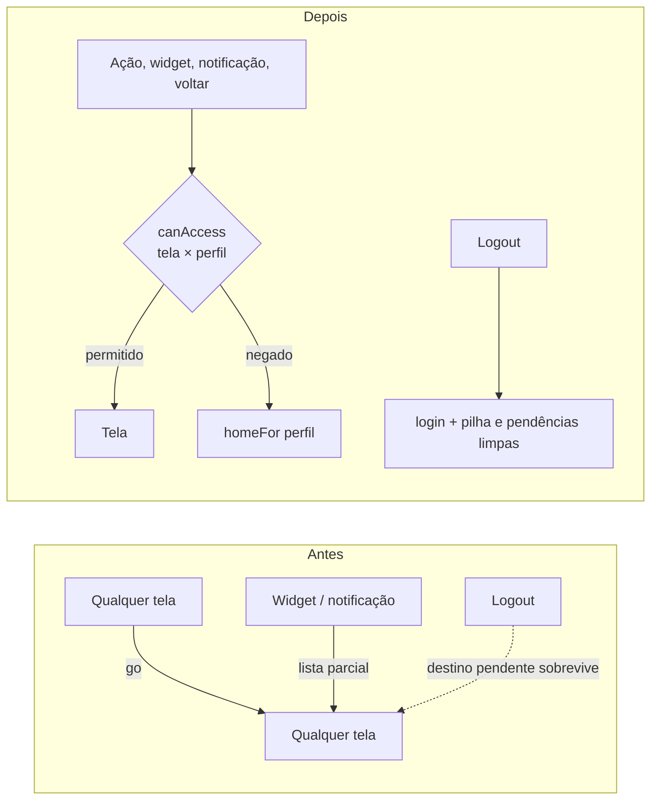

# Relatório final — área do cuidador e navegação

Branch: `feat/cuidador-ux-navegacao`. Veredito da verificação independente (Agente K, [verificacao.md](verificacao.md)): **aprovado com ressalvas** — a ressalva que sobrou é operacional (aplicar a migration). O Alto parcial (U5) e os três Médios apontados por K foram corrigidos depois do veredito.

Documentos da jornada: [diagnostico.md](diagnostico.md) → [problemas.md](problemas.md) (com status de cada Crítico/Alto) → [plano.md](plano.md) → [verificacao.md](verificacao.md).

## O que mudou

### Navegação
- Regras saíram do reducer para `app/src/navigation/navModel.ts` (puro e testado): `SCREEN_ACCESS` por tela, `canAccess` como **único guard** (go, back, goTab, replace, widgets, notificações, ações do Chat, render do RootNavigator), `pushHistory`/`popHistory`/`replaceHistory`.
- Cuidador não chega mais a telas do pet; usuário não chega a telas de cuidador por notificação.
- Logout limpa histórico, destino pendente e o widget do cuidador.
- Fins de fluxo (playlist, importação, check-in → mapa) usam `replace`; voltar físico na Home sai do app; nas outras abas leva à inicial; com tour aberto, fecha o tour.
- Deep links de widget passam por `navigation/deepLinks.ts` (inclui `tool?action=` e `playlist?id=`).
- Cadastro de cuidador e onboarding: "Voltar" da tela e voltar físico fazem o mesmo; sair da conta só com confirmação.

### Antes e depois

O fluxo completo novo, separado por perfil, está em [plano.md §1](plano.md).

### Área do cuidador
- **Painel:** cartões de todas as pessoas acompanhadas com estado recente, status do convite pendente, vazio útil ("gere um convite"), pedido "Preciso de você" sempre visível, falha de atualização mantém o último dado, zona de perigo para encerrar.
- **Novas telas:** Histórico (dia 14 / semana 12 / mês 6, por humor, em data local), Anotações por dia (criar, editar, apagar), Regras de alerta configuráveis, Notificações (alertas, pedidos, resumo semanal, silêncio noturno).
- **Resumo semanal por IA** (`POST /api/v1/care/weekly`, só agregados, texto não diagnóstico, rotulado como IA), com o resumo por regras como reserva.
- **Agenda** com seletor de data e hora; Plano e Agenda não perdem edições ao salvar.
- **Pessoa acompanhada:** aceite com **prévia** do que o cuidador vê e não vê e registro do termo (`care_consents`); Ajustes listam todos os cuidadores com pausar/encerrar por vínculo; nova tela "Do meu cuidador" (plano e compromissos).

### Backend
- Migration aditiva `supabase/migrations/202610300001_care_ux.sql`.
- Crise em 3ª pessoa ("falou em se matar", "não quer mais viver", "anda se cortando") detectada no servidor e no app, com os mesmos casos de teste nos dois.
- Copiloto aceita `top_emotion` desconhecida, cai no fallback com resposta vazia, 500 com headers de segurança.
- `care-push` respeita preferências e silêncio noturno e manda `cared_user_id` para abrir a pessoa certa.

### UX
- Token `onPri` (texto sobre a cor primária: 8,33:1 no escuro, antes 2,03:1); `t2`/`t3` com contraste AA; piso de 11 px.
- `Touchable` com papel de botão, área de toque de 44 px e feedback preservado; `Toggle`, `Chip`, `Segmented`, `TabBar` com papel e estado para leitor de tela.
- Campo focado visível acima do teclado no Android e no iOS.
- Mensagens perto do botão, estados loading/vazio/erro, confirmações em ações destrutivas.

## Decisões
- Navegação própria mantida (sem React Navigation/expo-router): reescrever 35 telas não trazia ganho; o problema era a falta de guard, resolvida com `navModel`.
- Testes com o runner nativo do Node já usado no projeto, não Jest/RNTL; lógica extraída para módulos puros.
- Migrations em Postgres/Supabase (o briefing citava SQLite, que não é usado).
- **Pausa esconde dados, não a voz da pessoa:** pedidos "Preciso de você" chegam mesmo pausado. Carinho fica indisponível durante a pausa.
- Resumo semanal guardado no aparelho, não no banco.
- Silêncio noturno padrão 22h–7h para quem nunca configurou; pedido "agora" fura o silêncio.
- Telas novas degradam com elegância se a migration ainda não foi aplicada.

## Testes
- App: tsc 0 erros, eslint 0 erros/0 avisos, **271/271** testes (inclui contrato de navegação, deep links, crise, núcleos das telas novas).
- API: **244** testes, 0 xfail (os 10 bugs marcados na auditoria foram corrigidos).
- Bundle Android gera sem erro; APK de release instalado no celular, hash conferido, cold start sem erro fatal.

## O que ficou para depois e por quê
- **Aplicar a migration** (`Desktop\MellowPet-migrations-4.sql`, depois das 1–3) e publicar a função `care-push`: depende do acesso do dono ao Supabase. Sem isso, pedido durante a pausa, registro do termo e as restrições novas de `care_requests`/gestos não valem.
- **Expo Go:** o app tem módulos nativos próprios (`mellow-*`), então não roda no Expo Go; o teste é pelo APK.
- Cores `OK`/`WARN` como texto no tema claro (~2,5:1): pede tokens `okText`/`warnText` em vários arquivos — próxima rodada.
- 13 achados Baixos de [verificacao.md](verificacao.md) (ex.: leitura de `care_consents` após revogar, cápsula do tempo vazia sem confirmação).
- Tabelas base (`caregiver_links`, `emotion_events`, `profiles`) seguem fora do repositório; vale exportar o schema do Supabase.
- Teclado e leitor de tela foram verificados por código; conferir no aparelho com TalkBack.
